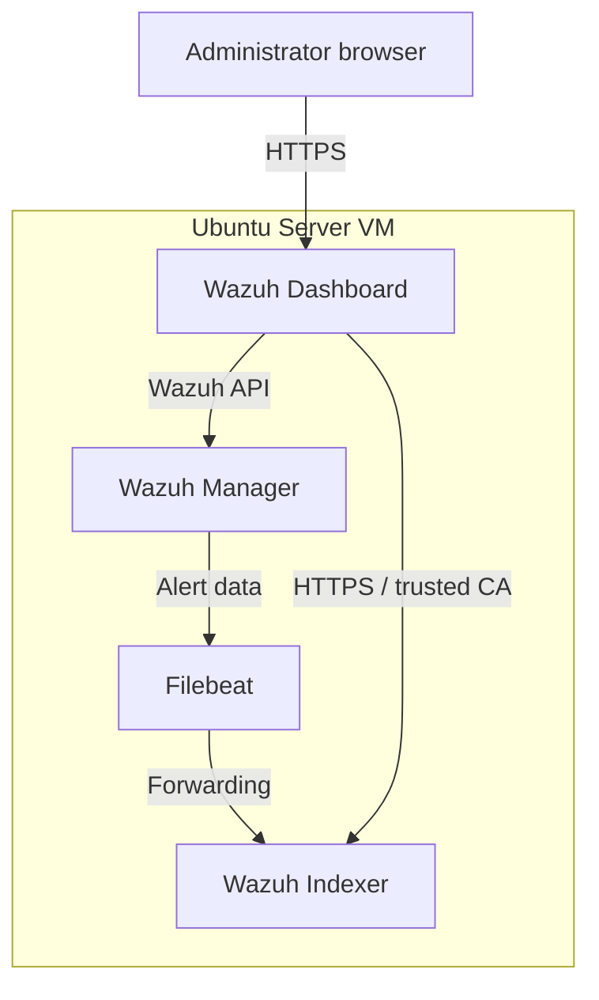

# Wazuh SIEM Deployment & Troubleshooting

  

I set up this project to document my Wazuh SIEM lab, the issues I ran into during deployment, and how I worked through them. The lab runs on Ubuntu Server in VirtualBox and uses the all-in-one Wazuh deployment.

Most of my troubleshooting was around getting the Dashboard to communicate properly with the Indexer, checking certificate trust, and making sure the main services were running.

## Dashboard

*This is a cropped screenshot from my lab. At the time I captured it, no agents had been enrolled. The alert numbers shown are dashboard counters; I have not treated them as proof of endpoint detections.*

## What I worked on

- Set up an all-in-one Wazuh server in an Ubuntu Server VM.
- Checked the Wazuh Manager, Indexer, Dashboard, and Filebeat services.
- Investigated Dashboard-to-Indexer authentication errors.
- Updated the internal service-account credential and matched it with the Dashboard keystore.
- Checked the root CA configuration and TLS communication between the Dashboard and Indexer.
- Checked whether the Wazuh API endpoint was reachable.
- Recorded the checks and remaining work.

## Lab layout

I used a single Ubuntu Server VM for the Wazuh components. The diagram below shows the main connections I worked with. It does not include the actual addresses or machine details from my lab.

## Components

| Component | What it does |
|---|---|
| Wazuh Manager | Handles agent communication and security analysis |
| Wazuh Indexer | Stores and indexes events |
| Wazuh Dashboard | Provides the web interface |
| Filebeat | Forwards alert data to the Indexer |
| Ubuntu Server | Runs the Wazuh services |
| VirtualBox | Hosts the lab VM |

## Troubleshooting notes

### Dashboard and Indexer authentication

I initially ran into Dashboard authentication errors. I checked the service logs, reviewed the Indexer connection settings, and checked the Dashboard keystore. The issue was related to the internal service-account credential not matching. I reset the credential and updated the Dashboard keystore so they were aligned.

### TLS and certificates

I also investigated TLS handshake errors. I checked the configured root CA, certificate file permissions, and whether the Dashboard service account could read the required files. I kept certificate verification enabled rather than bypassing it.

### Wazuh API

I checked the API endpoint and got an authentication-required response. That confirmed the endpoint was reachable, but I have not yet verified a successful API login. I have kept those two checks separate in this documentation.

## Validation at the time of capture

| Check | Result |
|---|---|
| Wazuh Indexer | Active |
| Wazuh Manager | Active |
| Filebeat | Active |
| Wazuh Dashboard | Active and accessible |
| Dashboard-to-Indexer TLS | Certificate trust checked |
| Wazuh API | Reachable; authentication still to be verified |
| Enrolled agents | 0 in the captured dashboard |
| Endpoint event testing | Not completed |

The screenshot showed 137 medium and 518 low severity counters, with zero high and critical counters. Since there were no enrolled agents in the screenshot, I am not presenting these figures as proof of endpoint monitoring.

## Repository contents

- [Architecture](docs/architecture.md)
- [Deployment and validation](docs/deployment-validation.md)
- [Troubleshooting notes](docs/troubleshooting.md)
- [Security and privacy](docs/security-and-privacy.md)
- [Screenshots](screenshots/README.md)

## What I learned

- Managing Linux services with systemd
- Checking service logs with journalctl
- Troubleshooting service-account credentials and keystores
- Understanding TLS certificates and CA trust
- Checking communication between Wazuh components
- Separating service reachability from successful authentication

## Still to do

- Enroll a test endpoint.
- Confirm that the endpoint appears in the Dashboard.
- Generate a controlled test event and verify that Wazuh receives it.
- Complete a successful Wazuh API authentication test.
- Add evidence for the detection tests once I have completed them.

I will update this repository as I complete those checks.

## Security note

I have left out private IP addresses, PC names, usernames, credentials, API keys, tokens, and certificate/private-key files. The screenshots and examples in this repository should not expose details from the actual lab network.

This is a personal lab project. Only use similar procedures on systems you own or are authorized to administer.
