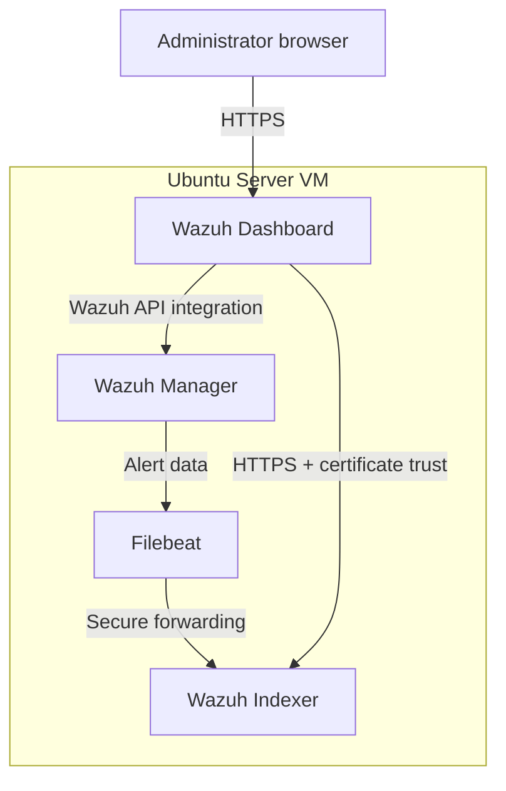

# Wazuh SIEM Deployment & Troubleshooting Lab

A hands-on security operations lab focused on deploying and troubleshooting a self-hosted Wazuh SIEM stack. The work covered the core Wazuh services, secure Dashboard-to-Indexer communication, service health checks, certificate trust, and investigation of authentication failures.

> **Project scope:** This repository documents a personal lab deployment and the troubleshooting performed. It is not a production reference architecture or a claim of completed endpoint monitoring. At the captured validation point, the Wazuh dashboard was available, the core services were running, and no agents were registered.

## Dashboard evidence

*Sanitized capture from the lab dashboard. The browser address bar and unrelated desktop context have been removed. The snapshot showed zero registered agents; the displayed alert totals are dashboard counters and are not presented as endpoint-detection results.*

## Project goals

- Deploy the Wazuh server-side components in an isolated Ubuntu Server virtual machine.
- Understand the roles and interactions of the Manager, Indexer, Dashboard, and Filebeat.
- Troubleshoot Dashboard-to-Indexer authentication and TLS trust problems.
- Verify service state, local HTTPS connectivity, certificate validation, and API endpoint reachability.
- Document what was verified, what remained incomplete, and how sensitive deployment details were protected.

## Lab architecture

The lab used an Ubuntu Server virtual machine hosted in VirtualBox. Its network adapter was configured in bridged mode for controlled access from the host network.

The diagram is a logical view of the components investigated in this lab. It intentionally omits real addresses, hostnames, usernames, and certificate details.

## Components

| Component | Role in the lab |
|---|---|
| Wazuh Manager | Central security monitoring and analysis service |
| Wazuh Indexer | Stores and indexes security events |
| Wazuh Dashboard | Web interface for operational visibility |
| Filebeat | Forwards alert data to the indexer |
| Ubuntu Server | Host operating system for the SIEM virtual machine |
| VirtualBox | Hypervisor used to run the lab VM |

## Work performed

### 1. Deployment and service checks
- Worked with an all-in-one Wazuh virtual-machine deployment.
- Checked the systemd state of the Manager, Indexer, Filebeat, and Dashboard services.
- Confirmed the four core services were active after troubleshooting.

### 2. Dashboard-to-Indexer authentication troubleshooting
- Investigated Dashboard authentication failures and an initial unavailable/503 dashboard state.
- Traced the issue to an inconsistent internal service-account credential.
- Updated the relevant credential and synchronized the Dashboard keystore configuration.
- Restarted and rechecked the affected services.

### 3. TLS and certificate validation
- Investigated TLS handshake failures, including certificate trust errors.
- Reviewed the shared root CA configuration used by the Indexer, Dashboard, and Filebeat components.
- Checked certificate file accessibility from the Dashboard service account.
- Verified the Dashboard's certificate-based trust configuration for the Indexer connection.

### 4. API connectivity checks
- Checked the Wazuh API service state and local endpoint reachability.
- Confirmed the API endpoint responded with an authentication-required response.
- **API authentication was not recorded as successfully completed** and is therefore not claimed as validated.

## Validation snapshot

The following results are based on the captured lab evidence, not assumptions:

| Check | Observed result |
|---|---|
| Wazuh Indexer service | Active / running |
| Wazuh Manager service | Active / running |
| Filebeat service | Active / running |
| Wazuh Dashboard service | Active / running |
| Dashboard availability | Accessible after troubleshooting |
| Dashboard-to-Indexer TLS trust | Certificate validation checked |
| Wazuh API endpoint | Reachable; authentication required |
| Registered endpoint agents | 0 at the captured snapshot |
| Endpoint telemetry validation | Pending |

The dashboard snapshot displayed 137 medium-severity and 518 low-severity counters, with zero high- and critical-severity counters. Because no agents were registered at that point, these counters must not be interpreted as proof of endpoint monitoring or as confirmed security incidents.

## Repository guide

- [Architecture](docs/architecture.md) — component roles and data flow.
- [Deployment and validation notes](docs/deployment-validation.md) — environment, checks, and evidence boundaries.
- [Troubleshooting notes](docs/troubleshooting.md) — authentication, TLS, service health, and API checks.
- [Security and privacy](docs/security-and-privacy.md) — redaction policy and safe publication practices.
- [Screenshots](screenshots/README.md) — sanitized evidence included in this repository.

## Skills demonstrated

- Linux service administration with systemd
- SIEM component deployment and troubleshooting
- OpenSearch/Indexer connectivity concepts
- TLS certificate trust and CA validation
- Service-account credential and keystore troubleshooting
- Log inspection with journalctl
- API reachability and authentication-boundary validation
- Technical documentation and evidence-based reporting

## Current limitations and next steps

- Enroll a dedicated test endpoint using a newly generated agent authentication key.
- Verify agent connectivity and confirm the endpoint appears in the Wazuh dashboard.
- Generate controlled test events and validate their ingestion and visibility.
- Validate Wazuh API authentication separately.
- Build and test focused detection use cases and document their expected/observed results.

These items are intentionally marked as pending until supported by fresh test evidence.

## Safety and privacy

This public repository uses sanitized screenshots and generalized configuration examples. It does not include private network addresses, real device names, usernames, credentials, authentication keys, private keys, CA files, or other deployment secrets. Never commit live configuration files or secret material.

This lab was performed in an environment the author was authorized to administer. Use the procedures only on systems and networks where you have permission.

---

*Independent hands-on lab project. Documentation reflects the work and evidence available at the time of publication.*
