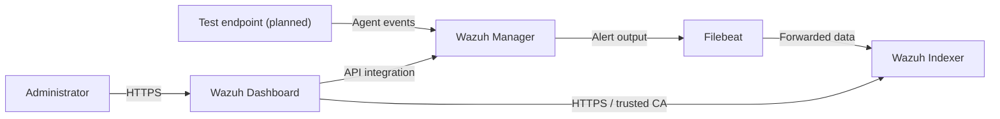

# Lab Architecture

I ran the Wazuh components together on one Ubuntu Server virtual machine hosted in VirtualBox. The VM used bridged networking so I could access the lab from my host machine.

I have left out the actual network addresses, hostnames, and machine names.

## Components

| Component | Purpose | What I checked |
|---|---|---|
| Wazuh Manager | Agent communication and security analysis | Service state and API endpoint reachability |
| Wazuh Indexer | Stores and indexes events | Service state and HTTPS connectivity |
| Wazuh Dashboard | Web interface | Service state and dashboard access |
| Filebeat | Sends alert data to the Indexer | Service state |

## Data flow

The endpoint is shown as a planned part of the lab. No agents were registered in the dashboard screenshot, so I have not claimed that endpoint event collection has been tested.

## Connections I checked

- Browser to Dashboard over HTTPS.
- Dashboard to Indexer over HTTPS, with CA trust configured.
- Dashboard to Manager through the Wazuh API. I checked reachability, but did not complete API authentication.
- Manager alert forwarding through Filebeat.

## Notes

This is a small learning lab, not a production or high-availability deployment. A production setup would need proper sizing, access controls, network segmentation, backups, certificate lifecycle management, and recovery planning.
