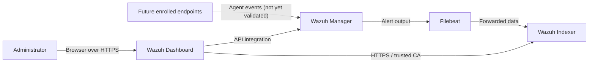

# Architecture

## Environment

The deployment was an all-in-one Wazuh lab hosted on an Ubuntu Server virtual machine in Oracle VirtualBox. The VM network adapter was configured for bridged networking so the lab could be reached from the host environment.

Private network details and machine identifiers are deliberately omitted from this public document.

## Logical components

| Component | Responsibility | Validation performed |
|---|---|---|
| Wazuh Manager | Receives and analyzes endpoint security data; exposes the Wazuh API | Service state checked; API endpoint reachability checked |
| Wazuh Indexer | Indexes and stores alert/event data | Service state and HTTPS connectivity checked |
| Wazuh Dashboard | Web interface and integration layer | Service state checked; dashboard opened after troubleshooting |
| Filebeat | Ships alert data from the Manager to the Indexer | Service state checked |

## Logical data flow

The endpoint node is shown as a future integration point. No agents were registered in the captured dashboard snapshot, so endpoint event ingestion is not claimed as completed.

## Trust boundaries

- Administrator browser to Dashboard: web access over HTTPS.
- Dashboard to Indexer: HTTPS with certificate-authority validation configured.
- Dashboard to Manager: Wazuh API integration; endpoint reachability was checked, but successful API authentication was not verified.
- Manager to Indexer: alert forwarding through Filebeat.

## Design notes

This is a learning and troubleshooting lab, not a high-availability or production-hardened architecture. A production design would require explicit sizing, access-control review, certificate lifecycle management, backups, network segmentation, monitoring, and documented recovery procedures.
